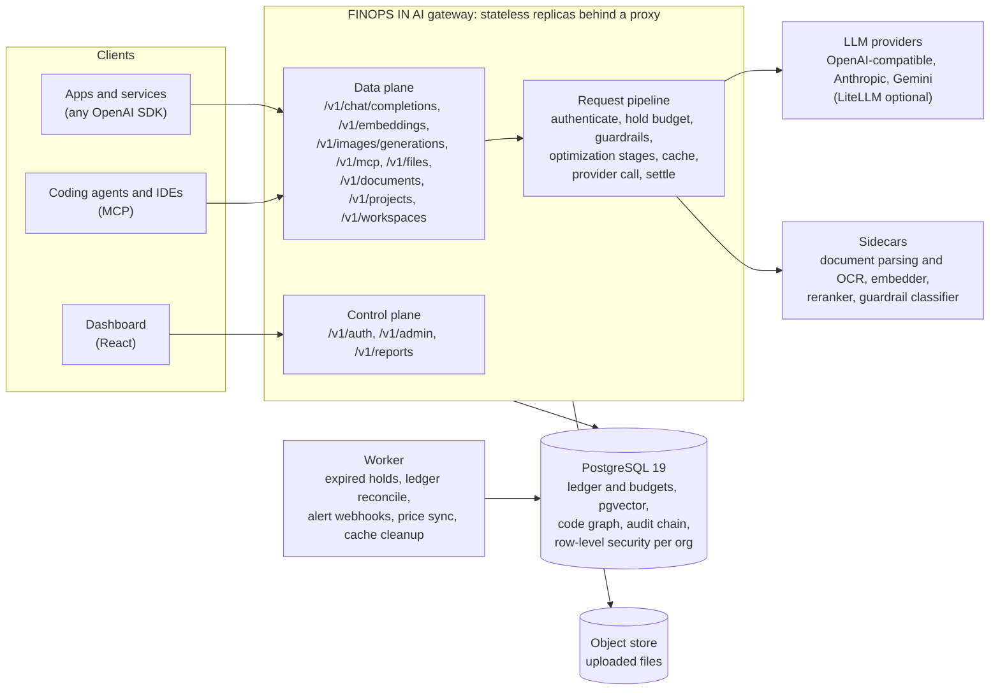
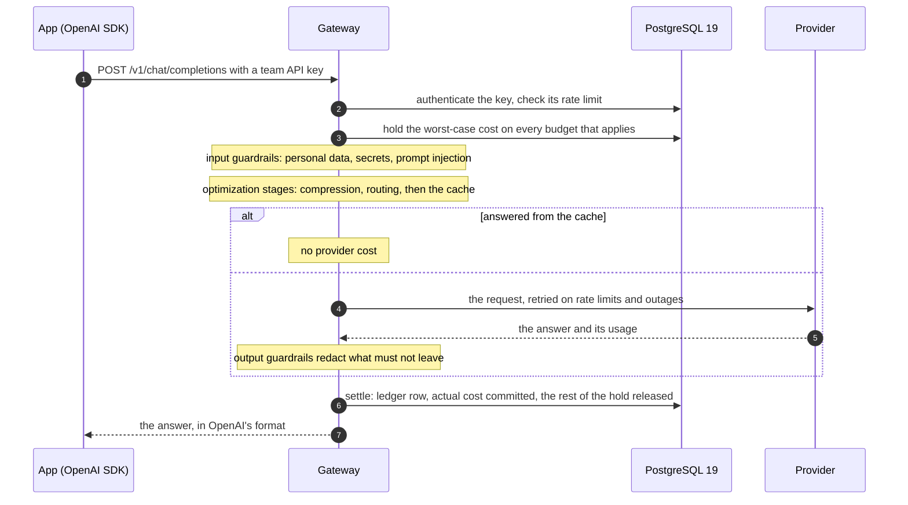
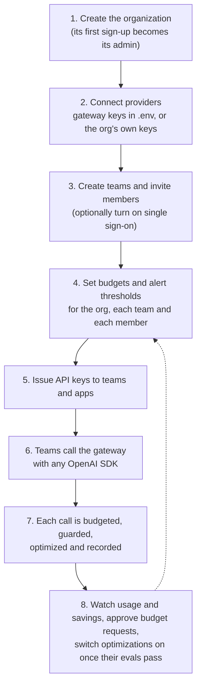

# FINOPS IN AI

[](https://github.com/mukulkathuria/finops_in_ai/actions/workflows/ci.yml)
[](https://github.com/mukulkathuria/finops_in_ai/actions/workflows/load.yml)
[](https://github.com/mukulkathuria/finops_in_ai/actions/workflows/upgrade.yml)
[](LICENSE)

**One gateway between your organization and every LLM. It controls what AI costs, who spends it,
and what data leaves.**

FINOPS IN AI is a self-hosted gateway that every LLM call in an organization goes through: chat,
embeddings, images and documents. Teams keep the OpenAI SDKs they already use. The gateway:
- holds budget before any money is spent;
- lowers cost with caching, model routing and prompt compression;
- keeps personal data and secrets out of prompts and answers;
- records every cent in a ledger.

It runs on one PostgreSQL 19 database: relational data, pgvector embeddings and a code knowledge
graph.

## The problem

At the scale of an organization, LLM spend grows faster than anyone can see it.

- **No limits.** Any API key can spend without a ceiling. A loop in an agent, a careless batch job
  or a leaked key becomes a surprise invoice at the end of the month.
- **No visibility.** There are several providers, many teams and shared keys. Nobody can say which
  team, app or person spent what, or whether the spend paid off.
- **No control over subscriptions.** Provider accounts and keys are scattered across teams.
  Revoking access, rotating a key or moving traffic to another provider means chasing every app.
- **Paying more than once.** The same questions are answered again and again. Simple prompts go to
  the most expensive models. Prompts carry tokens that change nothing.
- **Data leaving the building.** Prompts carry customer data, secrets and internal documents to
  third parties, and retrieved documents can carry injected instructions.
- **Agents multiply all of this.** Each agent and coding assistant reads the same code and
  documents again, and agents working together repeat each other's work.

FINOPS IN AI puts one point of control in front of all of it. The organization owns the provider
accounts, sets the limits, and sees every request, its cost, and what it saved.

## Twelve dimensions it covers

### 1. One gateway for every provider
- An OpenAI-compatible API (`/v1/chat/completions`, `/v1/embeddings`, `/v1/images/generations`,
  `/v1/models`) in front of OpenAI and OpenAI-compatible servers, Anthropic and Gemini.
- LiteLLM is an optional adapter for more providers.
- Apps change one base URL. Streaming and tool calls work as they do at the provider, and an
  `Idempotency-Key` makes a retried request safe.

### 2. Provider subscriptions and keys
- The organization holds the provider accounts. A provider can use gateway-wide keys from the
  environment, or each org's own keys (bring your own key).
- Stored keys are sealed with envelope encryption and never returned.
- Teams and apps get gateway API keys instead, which can be revoked at once, so a provider key
  never sits in an app.

### 3. Budgets with hard limits
- Budgets for the org, each team and each member, per day, week or month, in USD, tokens or
  images.
- The worst-case cost is held before a call and settled after it, so parallel requests cannot
  overshoot a limit: tested with 500 requests at once.
- Soft thresholds send alerts to a signed webhook.
- Members ask for more budget, and team leads or admins approve it once or permanently.

### 4. A cost ledger and reports
- Every request lands in a ledger: who, which team and key, which model, the tokens, the cost, and
  whether the cache or the router served it.
- Members see their own usage and remaining budget.
- The savings report compares actual spend with what the same requests would have cost without
  optimization, technique by technique.
- Prices come from a price catalog that follows a price list. Suspicious price changes are held
  back.

### 5. Smart model routing
- Prompts that a smaller model can answer go to the cheaper tier of the org's model pair.
- A judge samples routed answers and measures how far they agree with the larger model, so the
  savings come with a measured quality.
- Teams can opt out, and a routing report shows the effect.

### 6. Response cache, exact and semantic
- A repeated question, or one close in meaning, is answered from the org's cache at no provider
  cost.
- Cache keys are bound to the org, team, user, model parameters and guardrail policy, so an answer
  never crosses a boundary.
- Answers are stored encrypted, with an expiry and a per-org cap.

### 7. Optimization you can trust: shadow mode and eval gates
- Every optimization is a stage: prompt compression, the cache and the router.
- A new stage runs in shadow first: it reports what it would have saved without changing a single
  answer.
- It can be switched on only once its evaluation run passes, and a failing evaluation puts it back
  in shadow.

### 8. Guardrails and data protection
- Personal data and secrets are detected in prompts, then redacted or blocked per policy.
- Prompt injection is caught by rules plus a classifier (Laya or Jev), and output guardrails
  filter answers as they stream.
- Image prompts pass moderation before any spend.
- Decisions are logged without the values they protect.

### 9. Documents and retrieval under permissions (RAG)
- Uploads are validated from their bytes: type, size, page count, zip bombs, and malware through
  ClamAV.
- Office files, PDFs and scans become Markdown, using OCR (GLM-OCR or PaddleOCR-VL) where pages
  have no text.
- Documents are indexed in pgvector. Retrieval filters by access-control groups inside the query,
  so a person is never given a passage they may not read, and the model never sees it.

### 10. A code knowledge graph for coding tasks
- Code projects are indexed into a graph of modules, symbols, calls and imports, stored in
  PostgreSQL.
- Coding agents ask for a context pack: the code a task touches, in a fraction of the tokens a
  file dump costs.
- Walks of two or three hops answer in about 2 ms at a million edges.
- The same context is served to IDEs and agents as MCP tools (`/v1/mcp`).

### 11. A shared workspace for agents
- Agents working on one task share memory through MCP:
  - facts stored once and found by key or by meaning;
  - summaries of files already read;
  - questions between agents, with duplicates merged and loops refused.
- Each agent's discovery tokens are counted per task and capped by its budget.

### 12. Identity, security and operations
- **People and access:**
  - organizations, teams, invitations and roles (`org_admin`, `team_lead`, `member`, `finance`,
    `auditor`);
  - sessions with rotating refresh tokens;
  - single sign-on through each org's OpenID Connect provider.
- **Tenant isolation:** every org's data is fenced by forced PostgreSQL row-level security,
  audited in CI.
- **Audit:** a tamper-evident log, hash-chained, with a verify endpoint.
- **Observability:** Prometheus metrics, OpenTelemetry traces, and JSON logs without prompt text.
- **Operations:** Terraform environments, a restore drill, an upgrade rehearsal and runbooks.

## Architecture



| Component | Role |
| --- | --- |
| Gateway | FastAPI on Python 3.14, stateless, scaled with replicas behind a proxy. The data plane serves models, files, retrieval, code context and workspaces; the control plane serves sign-in, administration and reports |
| PostgreSQL 19 | The one database: relational data, the ledger, pgvector embeddings (HNSW per partition), the code graph and the audit chain. Every tenant table has forced row-level security |
| Worker | Background jobs: returns the holds of requests that died, rebuilds budget counters from the ledger, delivers alert webhooks through an outbox, syncs prices and cleans the cache |
| Sidecars | Swappable services behind ports: document parsing and OCR, the embedder (bge-m3), the reranker, guardrail classifiers |
| Dashboard | React: teams, keys, budgets, budget requests, usage, savings, audit |

The code follows ports and adapters: `gateway/domain` is pure logic, `gateway/ports` holds the
interfaces, and `gateway/adapters` holds every vendor integration. Swapping a provider, a
classifier or the OCR backend is configuration, not code.

### A request, step by step



A request that would exceed a budget is refused with `429`, naming the scope that ran out and how
to ask for more, before anything is spent.

## User flow



| Role | Typical work |
| --- | --- |
| `org_admin` | Providers and keys, teams, org budgets, guardrail policy, optimization stages, single sign-on |
| `team_lead` | Members, member limits, team API keys, the team's budget requests |
| `member` | Uses the allowed models within limits, sees own usage, asks for more budget |
| `finance` | Reads reports, exports, prices and savings |
| `auditor` | Reads the audit log and configuration history |
| Apps and agents | Call the data plane with a team API key: chat, embeddings, images, retrieval, MCP tools |

## Installation

Prerequisites:
- Docker with Compose v2;
- [uv](https://docs.astral.sh/uv/), which fetches Python 3.14 itself;
- Node 24+, only to work on the dashboard.

### 1. Start the stack

```bash
git clone https://github.com/mukulkathuria/finops_in_ai.git
cd finops_in_ai
uv sync                                  # Python dependencies (locked)
uv run python scripts/init_env.py        # writes .env with fresh random secrets (never overwrites)
docker compose up -d --build --wait      # PostgreSQL 19, migrations, gateway, worker, dashboard, mock LLM
curl http://127.0.0.1:8080/readyz        # {"status":"ok", ...}
```

If port 5432 is taken on your host, create the env file with
`POSTGRES_PORT=55432 uv run python scripts/init_env.py`. Every published port binds to `127.0.0.1`
only.

### 2. Create your organization

Open the dashboard at <http://127.0.0.1:5173> and create your organization. With the default
`SIGNUP_MODE=bootstrap`, only the first organization can sign up, and its first user is the admin.
In the dashboard, create a team and an API key for it.

### 3. Send a first request

The development stack includes a mock provider, so this works without any provider account:

```bash
curl http://127.0.0.1:8080/v1/chat/completions \
  -H "Authorization: Bearer $FINOPS_API_KEY" -H "Content-Type: application/json" \
  -d '{"model": "mock/mock-small", "messages": [{"role": "user", "content": "Hello"}]}'
```

Or with any OpenAI SDK:

```python
from openai import OpenAI

client = OpenAI(base_url="http://127.0.0.1:8080/v1", api_key="<your team's API key>")
answer = client.chat.completions.create(
    model="mock/mock-small", messages=[{"role": "user", "content": "Hello"}]
)
```

Models are named `<provider>/<model>`, and `GET /v1/models` lists the ones on offer. The
dashboard's usage and budget pages then show what the request cost.

### 4. Connect real providers

Set `OPENAI_API_KEY`, `ANTHROPIC_API_KEY` or `GEMINI_API_KEY` in `.env` and restart the gateway
(`docker compose up -d`). A provider is offered only when its key is set. An org can also store its
own key (`PUT /v1/admin/providers/{provider}/key`), sealed and never returned. Providers and their
base URLs are in `config/gateway.yaml`, prices in `config/prices.json`.

### 5. Production

- **Provision:** `scripts/env.sh up staging` provisions a production-like environment with
  Terraform, generating every secret ([`docs/runbooks/deploy.md`](docs/runbooks/deploy.md)).
- **Scale:** run the gateway as replicas with one process each, behind a proxy that balances
  requests. The `load` workflow measures exactly that.
- **Back up and restore:** follow [`docs/runbooks/restore.md`](docs/runbooks/restore.md); the
  restore drill proves a backup whole.
- **Handle incidents:** [`docs/runbooks/incident.md`](docs/runbooks/incident.md) covers provider
  outages, runaway spend, leaked keys and key rotation.

## Environment variables

`.env.example` lists every setting with a comment. `scripts/init_env.py` copies it to `.env` and
fills every `CHANGE_ME` with a fresh secret. Keep `.env` out of version control. A comment after an
empty setting must sit on its own line, because Compose would read it as the value.

### Generated for you: keep them secret, and keep them safe

| Variable | Purpose |
| --- | --- |
| `POSTGRES_PASSWORD`, `FINOPS_MIGRATOR_PASSWORD`, `FINOPS_APP_PASSWORD`, `FINOPS_WORKER_PASSWORD`, `FINOPS_READONLY_PASSWORD` | Database roles: superuser (container only), schema owner, gateway, worker, read-only reporting |
| `DATABASE_URL`, `WORKER_DATABASE_URL`, `MIGRATOR_DATABASE_URL`, `TEST_DATABASE_URL` | Connection strings for runs on the host (Compose builds its own) |
| `JWT_SIGNING_KEY` | Signs session tokens (Ed25519) |
| `MASTER_KEY` | Seals stored provider keys, webhook and single sign-on secrets, and cached answers. **Back it up apart from the database**: without it those cannot be opened |

### Set these before production

| Variable | Set it to |
| --- | --- |
| `ENVIRONMENT` | `production` or `staging`. Unset also means production, which refuses placeholder secrets and unsafe defaults |
| `SIGNUP_MODE` | `bootstrap` (first org only), `open` (multi-tenant service) or `disabled` |
| `WEB_BASE_URL` | The dashboard's public URL, used in invitation links |
| `PUBLIC_BASE_URL` | The gateway's public https URL, needed for single sign-on (empty turns it off). Serve the dashboard on the same host |
| `FORWARDED_ALLOW_IPS` | Your proxy's address, so per-address limits see real clients |
| `METRICS_TOKEN` | A bearer token for `/metrics`. Outside dev and test, `/metrics` is closed without one |
| `OTEL_EXPORTER_OTLP_ENDPOINT` | Your OpenTelemetry collector, to export traces |
| `LOG_LEVEL` | `INFO`; `DEBUG` adds per-call detail |

### Providers

| Variable | Purpose |
| --- | --- |
| `OPENAI_API_KEY`, `ANTHROPIC_API_KEY`, `GEMINI_API_KEY` | Gateway-wide provider keys. A provider is offered only when its key is set |
| `PROVIDER_ADAPTER_DEFAULT` | `native` (default) or `litellm` (the optional extra) |
| `MOCK_LLM_API_KEY` | The development mock only |

### Documents, retrieval and guardrails (point these at your own services)

| Variable | Purpose |
| --- | --- |
| `EMBEDDER_BASE_URL`, `EMBEDDER_MODEL`, `EMBEDDER_API_KEY` | Your bge-m3 embedding server (TEI, vLLM or Infinity); 1024-dimensional vectors |
| `RERANKER_BASE_URL`, `RERANKER_MODEL`, `RERANKER_API_KEY` | Your reranker (`/rerank` API); empty turns it off |
| `PARSER_BASE_URL`, `OCR_BACKEND`, `GLM_OCR_*`, `PADDLEOCR_VL_*`, `DOCPARSE_VLM_BASE_URL` | Document parsing and OCR (`glm_ocr` or `paddleocr_vl`, one at a time) |
| `CLAMAV_ADDRESS` | `host:port` of clamd to scan uploads; empty turns scanning off |
| `CLASSIFIER_BACKEND` | `rules`, `laya` or `jev`, for prompt-injection detection |
| `LAYA_BASE_URL`, `LAYA_API_KEY`, `JEV_API_KEY`, `JEV_BASE_URL`, `JEV_MODEL` | The classifier services. Jev is used only when its key is set |
| `MODERATION_BACKEND`, `MODERATION_BASE_URL`, `MODERATION_API_KEY` | Image prompt moderation: built-in `rules`, or an OpenAI-compatible moderation API |
| `OBJECT_STORE_PATH` | Where uploaded files are kept (a volume, or a shared mount for several replicas) |

### Limits and tuning (the defaults suit most installations)

| Variable | Default | Purpose |
| --- | --- | --- |
| `RATE_LIMIT_PER_MINUTE` | 1200 | Requests per API key or user |
| `HEAVY_RATE_LIMIT_PER_MINUTE` | 60 | Uploads and document work per API key or user |
| `AUTH_RATE_LIMIT_PER_MINUTE` | 30 | Sign-in and sign-up attempts per client address |
| `MAX_REQUEST_BYTES`, `MAX_UPLOAD_BYTES` | 10 MiB, 25 MiB | Body and upload size limits |
| `ACCESS_TOKEN_TTL_SECONDS`, `REFRESH_TOKEN_TTL_SECONDS` | 15 minutes, 14 days | Session lifetimes |
| `DB_POOL_SIZE`, `DB_MAX_OVERFLOW` | 20, 10 | Connections per gateway replica: keep the total under PostgreSQL's `max_connections` |
| `CACHE_MAX_ENTRIES_PER_ORG`, `MAX_INDEXED_CHUNKS_PER_ORG` | 50,000, 1,000,000 | Per-org cache and retrieval index quotas |
| `PRICE_SYNC_SOURCE` | `config/prices.json` | The price list the catalog follows (a file or an https URL) |

To rotate a key without signing everyone out, use `JWT_KEY_ID` with `JWT_PREVIOUS_PUBLIC_KEYS`, and
`MASTER_KEY_ID` with `MASTER_PREVIOUS_KEYS`. The steps are in
[`docs/runbooks/incident.md`](docs/runbooks/incident.md).

## Documentation

| Where | What |
| --- | --- |
| [`README_dev.md`](README_dev.md) | The developer guide: every feature's endpoints and rules, development commands, quality gates |
| [`PROGRESS.md`](PROGRESS.md) | Every user story with its commits and tests, open items, decisions taken during the build |
| [`docs/adr/`](docs/adr) | Architecture decisions |
| [`docs/runbooks/`](docs/runbooks) | Deploy, restore, incidents, the PostgreSQL upgrade |
| [`docs/threat-model.md`](docs/threat-model.md) | Threats, the controls against them, and the tests that prove them |
| [`docs/audits/`](docs/audits) | Phase reviews and the release audit |

## Questions and contributions

This project is open to your questions, ideas and contributions.

- **Questions or ideas:** open an issue. Describe what you are trying to do, and include the
  `x-request-id` of a failing request if there is one.
- **Bug fixes and features:** open a pull request. The development setup and the checks CI runs
  are in [`README_dev.md`](README_dev.md): linting, strict typing, layer contracts, unit and
  integration tests on PostgreSQL 19, and the security scans. Every change needs a test, and a bug
  fix needs a test that fails without it.
- **Security issues:** please report them privately to the maintainer, not in a public issue.

Licensed under the [MIT License](LICENSE).
